<div align="center">

# 💎 Classic Aero UI Studio

### *Tired of generic, low-density AI-generated flat web dashboards?*
**The High-Density, Tactile Enterprise Design System for WPF & AI Coding Agents.**

*"Stop building desktop apps that look like flat, pastel mobile web templates. Bring back real depth, crystal-clear Aero gloss, tactile precision, and true enterprise data density to modern .NET desktop software."*

**Pure XAML &amp; C#** · **Zero NuGet Dependencies** · **Extensible Vector Icon Engine** · **Dual Light &amp; Dark Aero Themes** · **Engineered for .NET 10**

[](LICENSE)
[](ClassicAeroStudio.csproj)
[](#-whats-included)
[](ClassicAeroStudio.csproj)
[](#-whats-included)
[](#-use-it-with-an-ai-agent)

<br/>

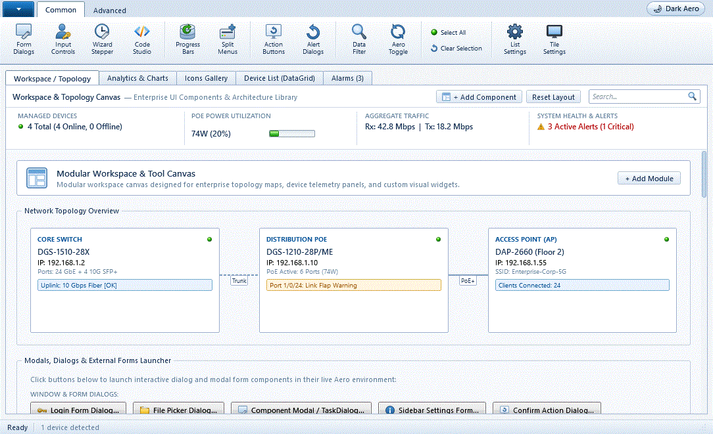

<br/>

### ⚡ Why Classic Aero?

| 🚫 The "Flat AI" Dilemma | ✨ The Classic Aero Solution |
| :--- | :--- |
| **Soulless pastel templates** that look like generic SaaS web apps | **Skeuomorphic crystal depth**, Aero gradients &amp; tactile realism |
| **Massive 48px paddings** wasting valuable desktop screen estate | **High-density 24px rows**, balanced controls &amp; maximum telemetry per pixel |
| **Dependency hell** (heavy third-party packages, DLL conflicts, breaking updates) | **Zero external dependencies** — 100% native, ultra-fast pure WPF XAML &amp; C# |
| **Inconsistent icon sets** mixing emojis, raster PNGs, and disparate SVG styles | **Extensible Vector Icon Engine** with strict Aero DNA rules for infinite expansion |

</div>

---

## 📖 Table of Contents

- [Why this exists](#-why-this-exists)
- [What's included](#-whats-included)
- [Use it with an AI agent](#-use-it-with-an-ai-agent)
- [Manual installation](#-manual-installation)
- [Switching themes at runtime](#-switching-themes-at-runtime)
- [Compatibility](#-compatibility)
- [Screenshots](#-screenshots)
- [Design rules](#-design-rules)
- [Component catalog](#-component-catalog)
- [Run the demo app](#-run-the-demo-app)
- [Project structure](#-project-structure)
- [Contributing](#-contributing)
- [License](#-license)

---

## 🎯 Why this exists

AI coding assistants tend to produce the same generic flat dashboard: large paddings, pastel buttons, soft borders, low data density. This project gives them (and you) a concrete alternative for dense desktop software: crisp 1px borders, glossy Aero gradients, compact 24px rows, and 3D status LEDs.

<div align="center">
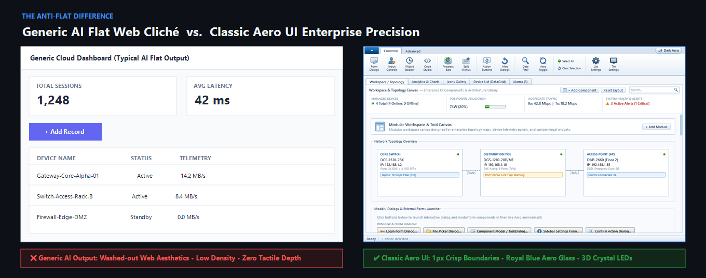
</div>

---

## 📦 What's included

| Part | Location | Description |
| :--- | :--- | :--- |
| Theme dictionaries | `Themes/` | 15 XAML resource dictionaries: Light master theme, Dark Aero theme and per-control styles |
| Vector Icon Engine | `Assets/Icons/ClassicIcons.xaml`, `references/` | Extensible vector icon system &amp; design guidelines for infinite, style-consistent icon creation |
| Theme manager | `Services/ThemeManager.cs` | Runtime Light/Dark switching and dark title bar via DWM |
| Demo application | `Views/`, `Controls/` | Dashboard, Explorer / MMC / Studio shells, settings windows, dialogs, wizard |
| Agent skill | `.agents/skills/classic-aero-ui/` | `SKILL.md`, reference guides, XAML templates and `install.ps1` |
| Agent rules | `AGENTS.md` | Design-exclusivity rules that agents must follow |

---

## 🤖 Use it with an AI agent

### Antigravity

Clone the repository into your project (or copy `.agents/skills/classic-aero-ui/` into it). Antigravity discovers skills under `.agents/skills/` automatically. Then prompt:

```text
Use the classic-aero-ui skill to restyle MainWindow and the settings dialog.
```

### Codex and Cursor

Both read `AGENTS.md` from the project root. Copy `AGENTS.md` and the `.agents/skills/classic-aero-ui/` folder into your project, then prompt:

```text
Read AGENTS.md and the classic-aero-ui skill, then convert this WPF view to Classic Aero.
```

### Claude Code

Claude Code reads `CLAUDE.md`. Add one line to it so the rules are loaded:

```markdown
@AGENTS.md
```

Then copy `.agents/skills/classic-aero-ui/` into your project and prompt as above.

> [!NOTE]
> Agent behaviour differs between tools and versions. If an agent ignores the rules, point it at `AGENTS.md` and `SKILL.md` explicitly in your prompt.

---

## 🛠 Manual installation

Clone the repository and run the installer from the root of **your** WPF project:

```powershell
git clone https://github.com/hidiraslan/aslan-skills.git
cd your-wpf-project
powershell -ExecutionPolicy Bypass -File ..\aslan-skills\.agents\skills\classic-aero-ui\scripts\install.ps1
```

The script copies `Themes/`, `Assets/Icons/`, `Services/ThemeManager.cs`, the app icon and `AGENTS.md` into your project. It does not edit your `App.xaml`, so register the dictionaries yourself:

```xml
<Application.Resources>
  <ResourceDictionary>
    <ResourceDictionary.MergedDictionaries>
      <ResourceDictionary Source="pack://application:,,,/Assets/Icons/ClassicIcons.xaml"/>
      <ResourceDictionary Source="pack://application:,,,/Themes/ClassicWindowsTheme.xaml"/>
    </ResourceDictionary.MergedDictionaries>
  </ResourceDictionary>
</Application.Resources>
```

Root windows should use the ClearType settings the theme expects:

```xml
<Window FontFamily="Segoe UI" FontSize="11"
        Background="{DynamicResource ClassicCanvasBackground}"
        SnapsToDevicePixels="True" UseLayoutRounding="True"
        TextOptions.TextFormattingMode="Display"
        TextOptions.TextRenderingMode="ClearType"
        TextOptions.TextHintingMode="Fixed"
        RenderOptions.ClearTypeHint="Enabled">
```

> [!TIP]
> The source files use the root namespace `ClassicAeroStudio`. When copying `ThemeManager.cs` into your own project, adjust the namespace to match your project if desired.

---

## 🌓 Switching themes at runtime

```csharp
using ClassicAeroStudio.Services;   // adjust to your namespace

ThemeManager.ApplyTheme(AppTheme.DarkAero);     // switch to Dark Aero
ThemeManager.ApplyTheme(AppTheme.ClassicAero);  // switch back to Light
```

Windows are updated in place, with no restart. The demo ribbon includes a pill switch wired to the same call.

---

## ✅ Compatibility

| Target | Status | Notes |
| :--- | :---: | :--- |
| .NET 10 (Windows) | ✅ Tested | The demo app builds with 0 errors and 0 warnings |
| .NET 6 – 9 | 🟡 Expected | Standard WPF XAML and C#; not individually tested |
| .NET Framework 4.5 – 4.8 | 🟡 Untested | The XAML uses core WPF primitives, but `ThemeManager.cs` and the demo use modern C# features that may need small adjustments |

Requires Windows. The dark title bar uses DWM and applies on Windows 10/11.

Reports for other runtimes are welcome through issues.

---

## 📸 Screenshots

### Dashboard

| Light Aero | Dark Aero |
| :---: | :---: |
| 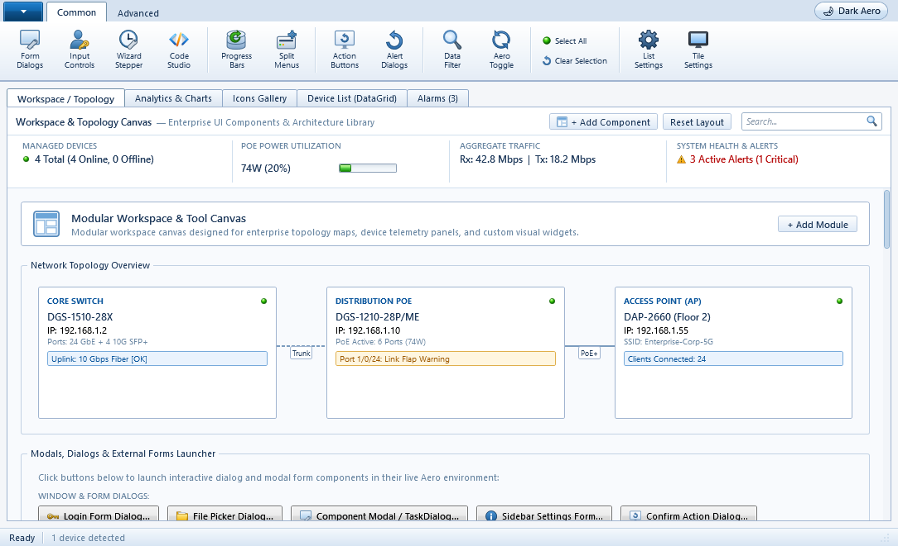 | 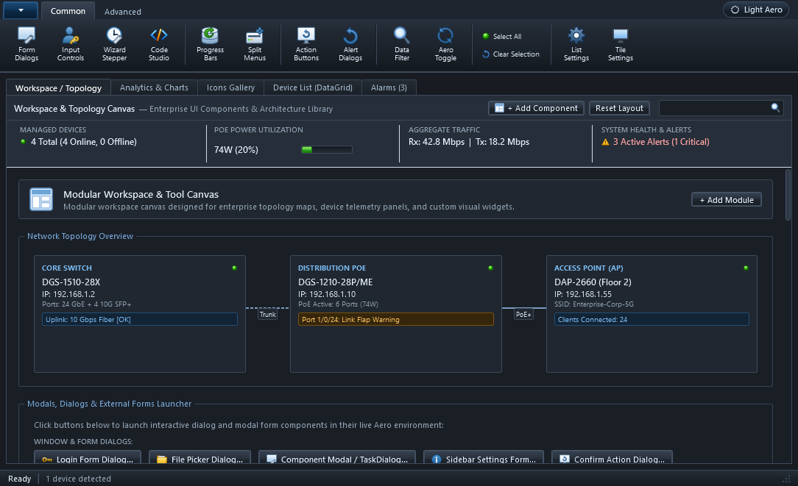 |

### Analytics and alarms

| Light analytics | Dark analytics |
| :---: | :---: |
|  |  |
| 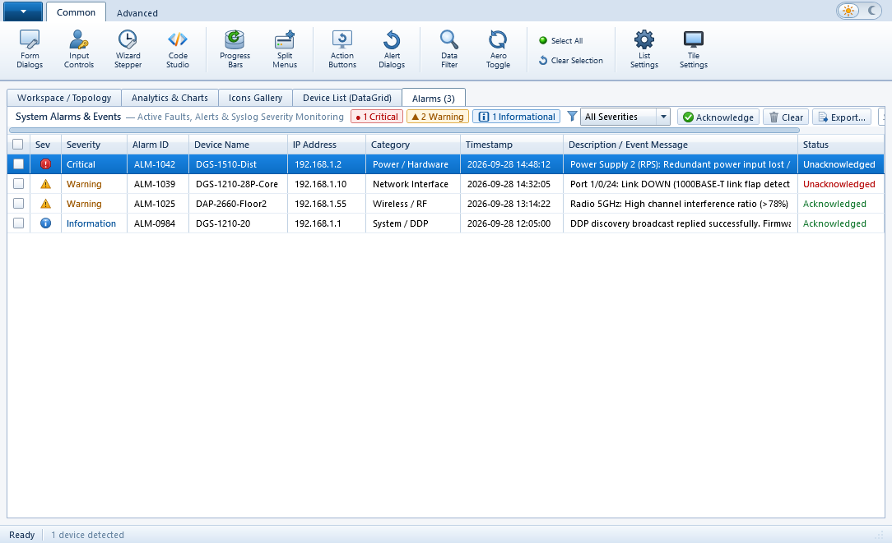 | 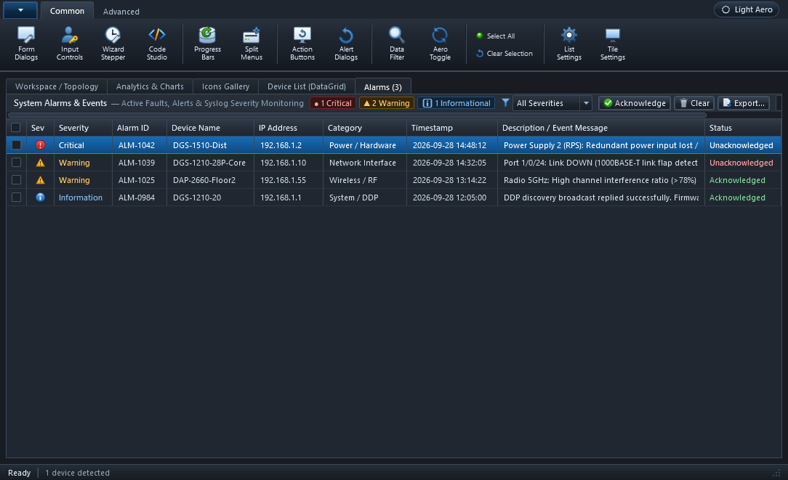 |

### Shell layouts

| Explorer shell | MMC console |
| :---: | :---: |
| 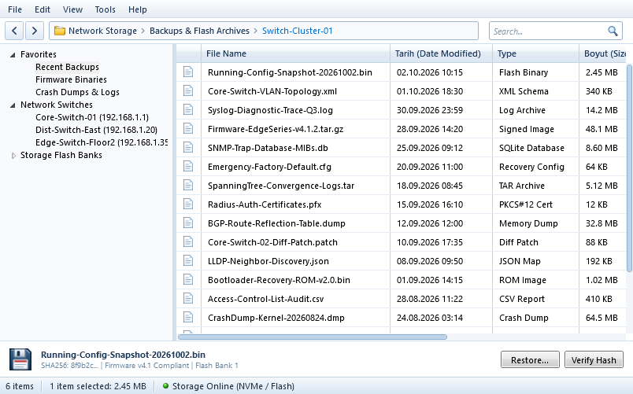 | 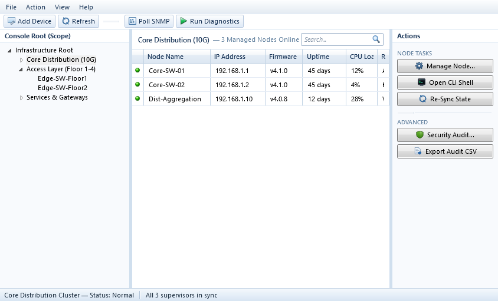 |
| 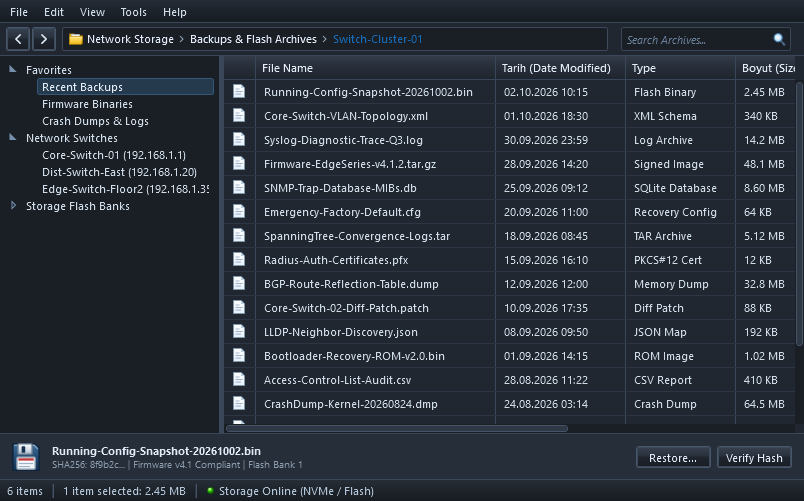 | 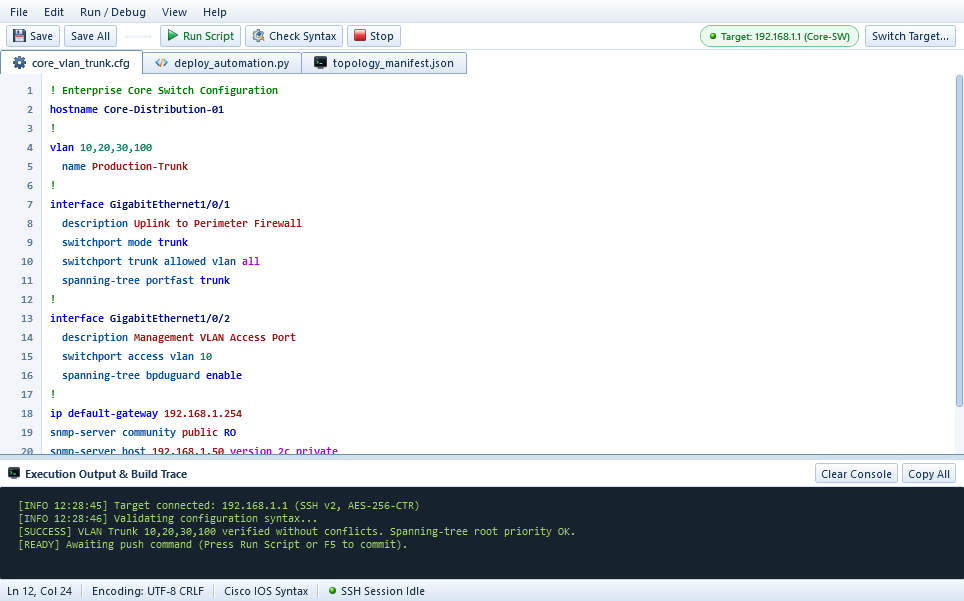 |

### Settings windows (two navigation modes)

| 180px list navigation | 130px tile navigation |
| :---: | :---: |
| 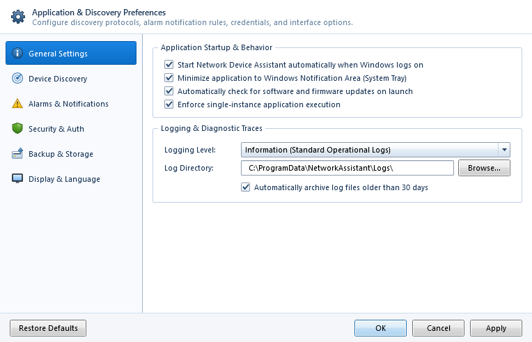 | 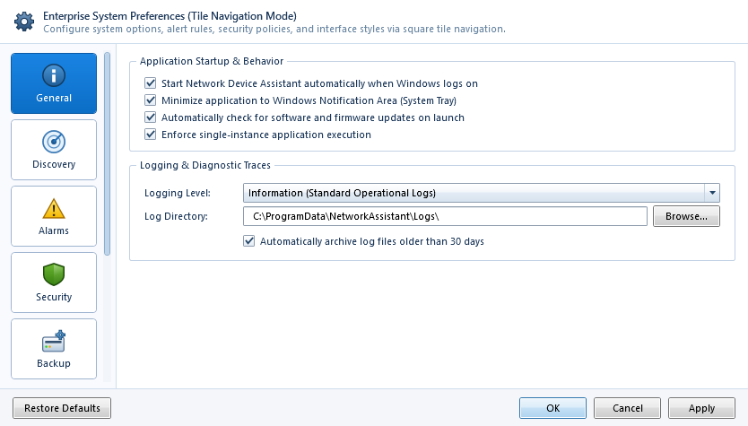 |
| 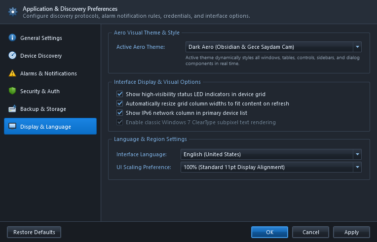 | 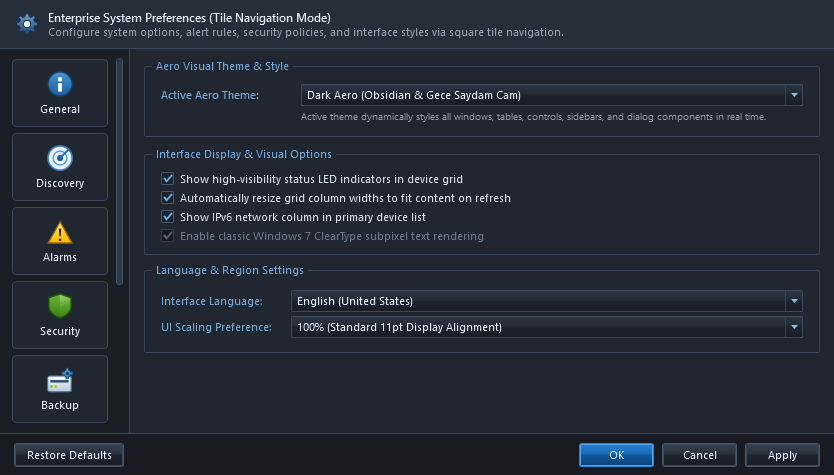 |

### Dialogs and wizard

| TaskDialog | Wizard |
| :---: | :---: |
| 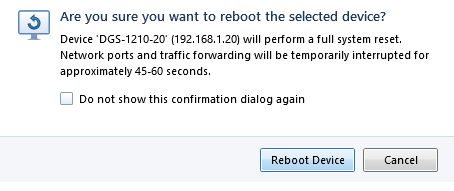 | 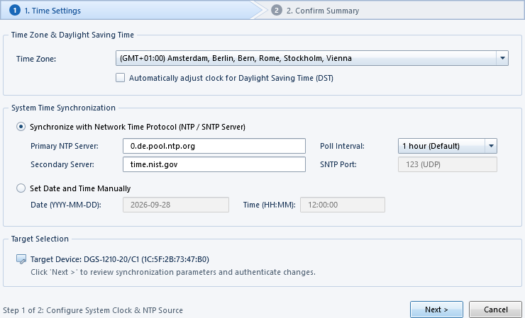 |
| 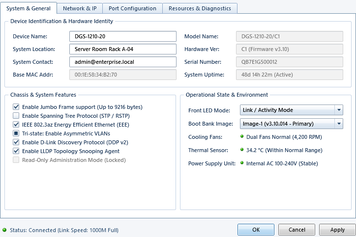 | 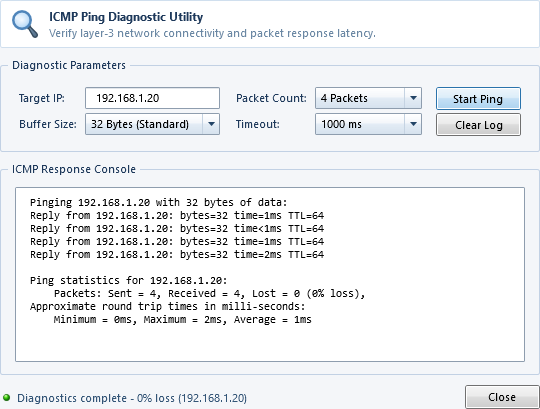 |

---

## 📐 Design rules

1. **1px law.** Borders are 1px with `SnapsToDevicePixels` and `UseLayoutRounding`, so no blurry double borders.
2. **ClearType text.** `TextFormattingMode="Display"` for sharp Segoe UI at small sizes.
3. **Density.** 24px grid rows, 18px in-row buttons, 34px sub-header bars.
4. **No outside UI libraries.** No `wpf-ui`, WinUI, MaterialDesign or MahApps. Everything comes from `Themes/` and `ClassicIcons.xaml`.
5. **No horizontal jump.** Global handlers stop TreeView and ScrollViewer from shifting sideways on focus, and stop menus from opening on hover.
6. **Two themes, one set of keys.** Light and Dark define the same resource keys, so controls restyle without code changes.

The full rule set lives in [`AGENTS.md`](AGENTS.md) and [`.agents/skills/classic-aero-ui/SKILL.md`](.agents/skills/classic-aero-ui/SKILL.md).

---

## 🧩 Component catalog

| Component | Style key | Notes |
| :--- | :--- | :--- |
| Standard button | `ClassicStandardButton` | Gray Aero button with blue hover glow |
| Default button | `ClassicDefaultButton` | Royal blue primary action |
| Success / Danger | `ClassicSuccessButton` / `ClassicDangerButton` | Green and red gloss variants |
| Command link | `ClassicCommandLinkButton` | 48px TaskDialog-style button |
| Row button | `ClassicRowButton` | 18px, fits 24px grid rows |
| DataGrid | `ClassicDataGrid` | 1px gridlines, LED status cells |
| Ribbon tabs | `ClassicRibbonTabStrip` | Office-style tab strip |
| Property tabs | `ClassicPropertySheetTabControl` | Windows property sheet tabs |
| Theme pill | `ClassicThemeTogglePill` | Light/Dark toggle capsule |
| Progress bar | `ClassicProgressBar` | Flush cylindrical bars |
| TaskDialog, Wizard | `TaskDialogTemplate.xaml`, `WizardDialogTemplate.xaml` | Templates under `.agents/skills/classic-aero-ui/examples/` |

---

## ▶️ Run the demo app

Requires Windows and the .NET 10 SDK or Desktop Runtime.

### Option A: One-Click Launcher
Simply double-click **`Launch-Demo.bat`** in the repository root to start the studio immediately.

### Option B: Terminal (.NET CLI)
```powershell
git clone https://github.com/hidiraslan/aslan-skills.git
cd aslan-skills
dotnet run
```

---

## 🗂 Project structure

```text
.
├── .agents/skills/classic-aero-ui/   # Agent skill: SKILL.md, references, examples, scripts
├── Assets/                           # App icon and ClassicIcons.xaml
├── Controls/                         # Toolbar, DeviceGrid, wizard header
├── Services/ThemeManager.cs          # Runtime theme switching
├── Themes/                           # Light, Dark and per-control dictionaries
├── Views/                            # Demo windows and dialogs
├── docs/                             # Screenshots and project page
├── AGENTS.md                         # Rules for AI agents
├── ClassicAeroStudio.csproj
└── LICENSE
```

---

## 🤝 Contributing

Issues and pull requests are welcome. Please keep changes within the Classic Aero rules above, include a light and a dark screenshot for any visual change, and make sure `dotnet build` finishes with no warnings.

---

## 📄 License

Released under the [MIT License](LICENSE).
